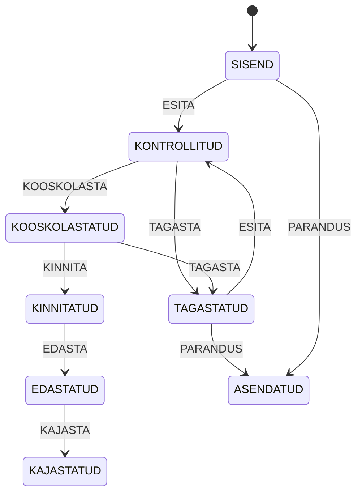

# Teise etapi tarkvara ja menetluse spetsifikatsioon

## Vastuvõtukriteeriumid

| ID | Nõue | Teostus |
|---|---|---|
| E2-01 | Arvete andmestik | 17 fiktiivset rida, kuus algset säilinud |
| E2-02 | Matemaatilised, aja- ja dimensioonikontrollid | 17 koodi failis KONTROLLIREEGLID.md |
| E2-03 | SQLite ja SQL | 0.1 → 0.2 migratsioon, toorandmed, kontrollid, logi, kanded |
| E2-04 | Menetluse ja RTK-vahetuse simulatsioon | Eraldi rollid ja kontrollsummaga JSON |
| E2-05 | Testid ja juhendid | Negatiivsed juhud, rollback, kordusimport ja -vastuvõtt |
| E2-06 | Kirjendamise selgitus | 25-minutiline moodul ja näidiskanne |

## Olekud ja rollid

Eksportimise funktsioon on `export_transfer`; käsureal kasutatakse käsku `export`.

| Näidiskasutaja | Roll | Lubatud toiming |
|---|---|---|
| analuutik | ANALUUTIK | Import, esitamine, parandus ja kinnitatud arve eksport |
| sisukinnitaja | SISU | Teenuse kooskõlastamine või tagastamine |
| eelarvejuht | EELARVE | Kooskõlastatud arve kinnitamine |
| rtk_demo | RTK | Täpse eksportpaketi simuleeritud vastuvõtt ja näidiskanne |

Need on lokaalsed näidisrollid, mitte sisselogimine ega turvaline mitme kasutajaga teenus. Andmebaasifaili omanik saab selle sisu muuta. Trigerid väldivad tavalisi logi UPDATE/DELETE käske, kuid ei taga administraatori eest krüptograafilist rikkumatust.

## Andmemudel ja migratsioon

Esimese etapi `001_skeem.sql` säilib. Uus `002_menetlus.sql` täiendab tühja või olemasolevat skeemi 0.2-ni. `initialize()` valib migratsiooni versiooni järgi ega käivita seda teist korda. Seda on testitud esimese etapi tühja prototüüpskeemi peal. Väliste kasutajate täidetud andmebaaside migreerimine ei ole testitud.

| Tabel | Sisu ja võtmed |
|---|---|
| input_document | document_id PK, muutmata raw_json, content_hash, creator_actor FK, importimise aeg, olek, versioon, eelmise versiooni FK |
| actor | actor_id PK ja näidisroll |
| check_run | run_id PK, document_id FK, kontrollpäev, aeg, reeglistiku versioon |
| validation_issue | issue_id PK, run_id FK, kood, tase, väli ja selgitus |
| document_event | event_id PK, dokumendi ja tegija FK, vana/uus olek, tegevus, aeg ja põhjus |
| transfer | transfer_id PK, unikaalne document_id FK, JSON, räsi, edastuse/vastuvõtu ajad, näidisviide |
| invoice + invoice_line | Esimese etapi tabelid; normaliseeritud arve tekib alles kinnitatud arve eksportimisel |
| journal_entry + journal_line | Teenuse kuupäeva alusel näidiskanne, D/K sendid |

Esimese etapi `check_result` ja `workflow_event` tabelid säilivad ühilduvuseks, kuid 0.2 neid ei täida: toorandmete vead peavad saama viidata ka arvele, mida normaliseeritud `invoice` tabelis veel ei ole. Kasuta päringutes `validation_issue` ja `document_event`. Avalike eelarvete tabelid jäävad selles etapis täitmata; esimese etapi andmed on CSV-des säilinud.

`invoice_id` on sisemine dokumendi/versiooni identifikaator. Tarnija arvenumber on eraldi ärivõti. Paranduseks antakse uus invoice_id ning seos eelmise versiooniga. Vana raw_json ei kirjutata üle. Kinnitatud või kajastatud dokumendi muutmine pole lubatud; kreedit- ja tühistuskanded on väljaspool 0.2 ulatust.

## Transaktsioonid ja audit

Import, parandus, olekumuutus ning näidiskande loomine on SQLite'i tehingud. Kui kande mõne rea lisamine ebaõnnestub, ei jää alles poolikut kannet. Kontrolli ajalugu säilib ka juhul, kui olekumuutus blokeeritakse. Üks arve võib tekitada siin maksimaalselt ühe journal_entry; kordusvastuvõtt tagastab sama viite.

## JSON-leping

Väljund sisaldab `schema_version`, `simulation=true`, `transfer_id`, `invoice_id`, `source_hash`, arve väljad ja käibemaksu näidispoliitika. Vastuvõtt võrdleb kogu kanoonilise JSON-i SHA-256 räsi varem salvestatud ekspordiga. Muudetud summa või tundmatu edastus lükatakse tagasi. See on lokaalne tervikluskontroll, mitte e-allkiri ega RTK tegelik vorming.

Korduseksport tagastab sama paketi ja ei loo uut arvet. Nii saab taastada JSON-faili ka siis, kui selle esialgne kettale kirjutamine ebaõnnestus pärast andmebaasi salvestamist.

## Piirid

Üks teenuse-/kaubarida arve kohta, EUR, positiivne neto, fikseeritud näidiskontod, ühe rea ROUND_HALF_UP ümardus. Tegelikke dokumente, pangakontosid ega isikuandmeid ei kasutata. Ühtlasi puuduvad osamaksed, kreeditarved, ettemaksed, maksete teostamine, lukustatud perioodide kalender ja tegelik eelarve piisavuse arvutus. Eelarvejuhi kinnitus on inimese simuleeritud otsus, mitte 3. etapi eelarvemootor.
