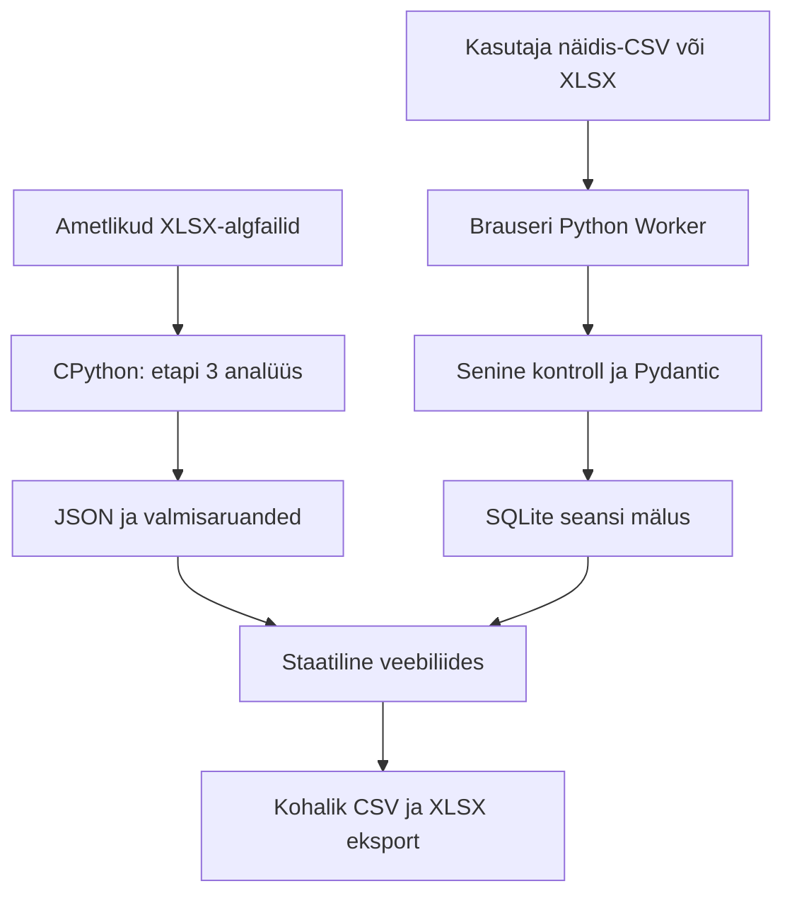

# Arhitektuur · 0.4

## Etapi 5 kehtiv täiendus

Etapp 5 ei lisa serverit ega AI-teenust. Säilib ehitusaegne Python/Polars/pandas/SQLite → JSON/Excel ning brauseri Worker → Pyodide → sama Pythoni menetlusmootor. Sisendpiirid on veeb_adapter.py-s, kasutaja veateate lühendamine worker.js-s. Avalik dist on eraldatud isiklikust kandideerimispaketist. Laienduste vajaduspõhine hinnang: TEHNOLOOGILINE_ANALUUS.md.

Staatiline veeb ja kaks Pythoni käituskohta. Ehitamise ajal CPython + Polars; kasutaja uute näidisarvete jaoks brauseris Pyodide + Pydantic + SQLite + openpyxl.

## Moodulid

| Asukoht | Vastutus |
|---|---|
| kood/etapp1.py | Allikate SHA-256, ühikud, väljavõtted ja kooskõlakontroll |
| kood/menetlus.py | Etapi 2 ärireeglid, duplikaadid, rollid, tehingud, audit |
| kood/andmeleping.py | Pydantic v2 sisendleping |
| kood/analuus.py ja etapp3_demo.py | Eelarve, kulud, toetused, SQL ja vormindatud Excel |
| kood/veeb_adapter.py | Sama mootorit kasutav veebiseanss ning import/eksport |
| kood/ehita_veeb.py | Analüüsi käivitamine ja dist/ koostamine |
| veeb/app.js | Vaated, otsing, filtrid, sort, graafik ja Worker-sõnumid |
| veeb/worker.js | Pyodide'i käivitamine ja adapteri kutsumine |
| veeb/runtime ja veeb/vendor | Kaasasolev fikseeritud Pythoni käituskeskkond ja teegid |

## Arvutuste piir

JS vormindab sendid eurodeks ja suhtarvud protsentideks, sorteerib ja filtreerib. Ärireeglid, käibemaks, duplikaadid, eelarveanalüüs ning toetuse summad arvutab Python. Arvete Worker kopeerib täpselt samad menetlus.py ja andmeleping.py failid; failide võrdsust kontrollib test.

Avalik analüüs on failipõhine hetkeseis. CSV/Exceli valikueksport ei tõmba uusi allikafaile ega arvuta teadmata kuueelarvet. Augusti seadusepildi kulusid ja septembri kulusid+investeeringuid ei ühendata ühte kasutamise protsenti.

## Brauseri andmete eluiga

Fail loetakse File API-ga brauseris, antakse Workerile ja salvestatakse :memory: SQLite'i. Pole brauseri kohalikku püsisalvestust, HTTP-uploadi ega serveri andmebaasi. Lehe uuendamisel või „Taasta algne näidis“ toimingul kaob lisatud seanss. Kasutajale öeldakse see enne importi. Valmisandmed jäävad alati kättesaadavaks ka siis, kui Python ei käivitu; import ja dünaamiline eksport vajavad töötavat Pythonit.

## Majutus

GitHub Pages ja Sites serveerivad dist/ faile. Serveripoolset Pythonit ega SQLite'i ei käivitata. Pyodide varad tulevad samalt originilt; Google Fontsi ebaõnnestumisel toimib süsteemifondi asendus. Moodul-Worker hoiab kontrollitöö kasutajaliidese lõimest eraldi. Piirid: 2 MB fail, 10 MB XLSX lahtipakitud sisu, 500 dokumenti seansis.

## Ühilduvus ja edasiarendus

Varasemad skeemid, payload 0.2 ja reeglistik 0.2.1 säilivad. Avaliku väljavõtte versioon on 0.4. Veeb ei paku kinnitamise või maksmise nuppe: see on kontrollimise ja analüüsi töökoht. API laiendus võib kasutada sama adapteri teenusekihti, kuid püsiv mitme kasutaja menetlus vajab serverit, autentimist ja rollikontrolli. AI laienduskohad on dokumenteeritud; viiendat etappi ei rakendata.
