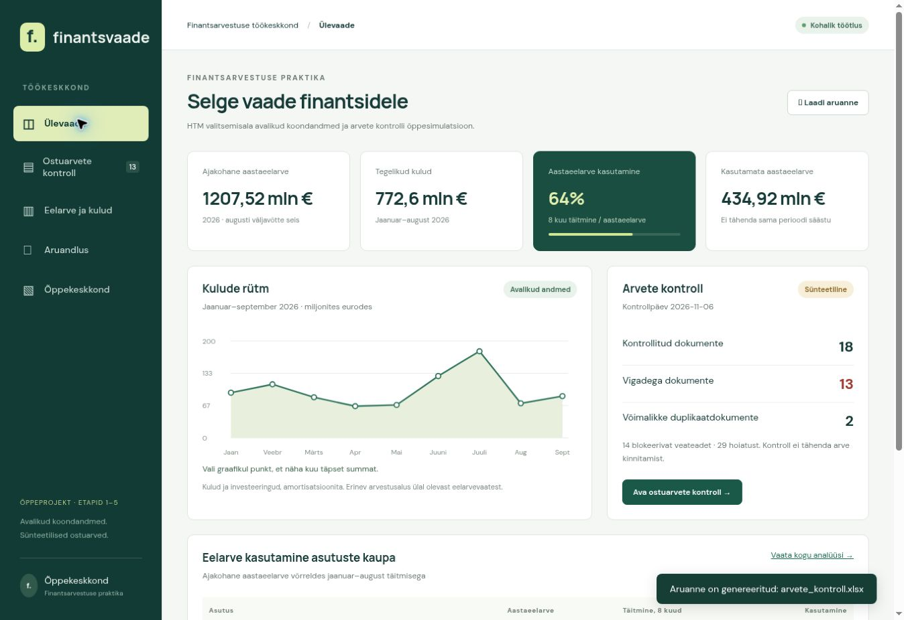
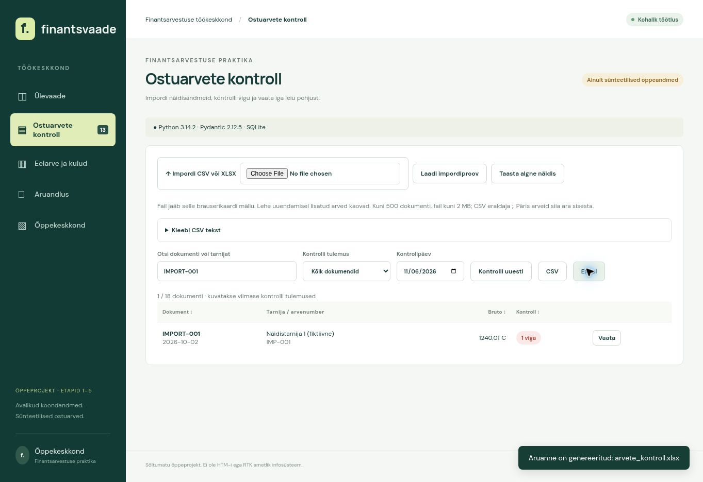
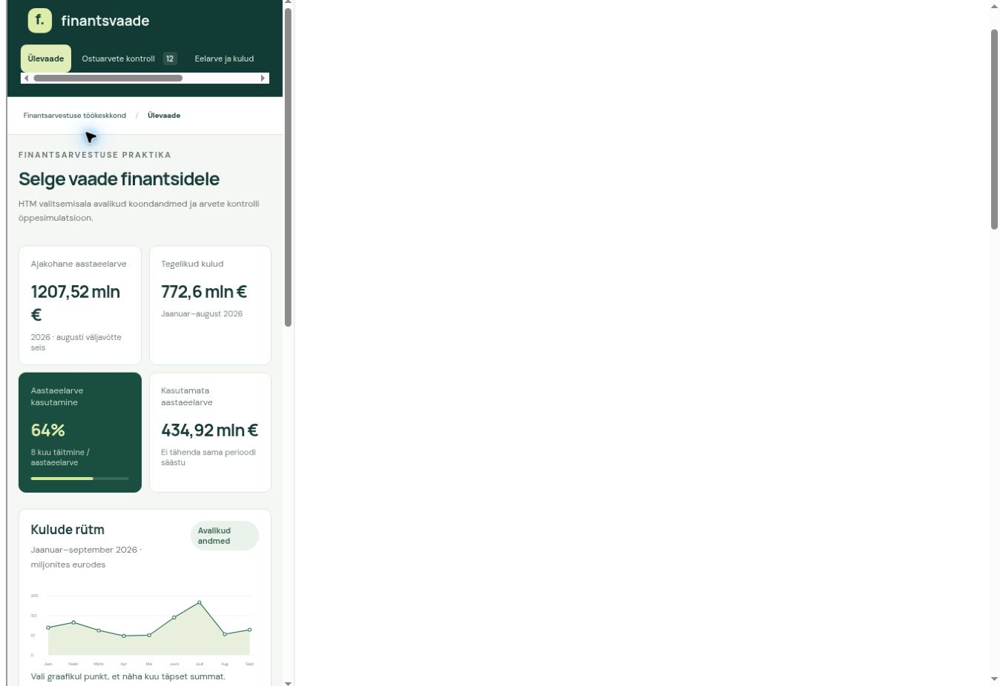

# Finantsvaade – ekraanipiltidega varuesitlus

Pildid pärinevad versiooni 0.5 tegelikust brauserikontrollist 7.11.2026. Need ei ole kujundusmaketid. Täispika demo jututekst: [esitluskava](DEMONSTRATSIOONI_KAVA.md).

## 1. Ülevaade (45 sekundit)

Aastaeelarve on 1207,52 mln eurot ja kaheksa kuu täitmine 772,6 mln eurot. Kasutamata aastaeelarvet ei nimetata säästuks. Graafik näitab eraldi üheksa kuu kulude ja investeeringute vaadet. Pildil on 18 arvet, sest algsele 17 näidisarvele lisati üks.

## 2. Kontroll ja eksport (90 sekundit)

IMPORT-001 bruto on 1240,01 eurot, kuid neto 1000 + KM 240 annab 1240 eurot. Mootor märgib ühe sendi erinevuse. Excelisse jõuavad sama dokumendi SUMMA viga ning perioodi/tähtaja hoiatused. Tähtaeg üksi ei tõenda, et arve on maksmata.

## 3. Kasutamine väikesel ekraanil (30 sekundit)

Vaadet kontrolliti 390, 768 ja 1280 piksli laiuses raamis. See ei asenda testi füüsilisel telefonil. Menüü ja tabelid võivad kerida oma konteineri sees.

## 4. Tehnoloogia ja minu roll (60 sekundit)

Python kontrollib ja arvutab, Pydantic kontrollib andmelepingut, Polars teeb koondanalüüsi, SQLite toetab päringuid ning Excel säilitab tuttava töövormi. AI abil loodud projekt näitab minu analüüsi- ja testimisoskust; see ei tõenda varasemat iseseisvat ministeeriumi raamatupidamise kogemust. Arvete kinnitamine, maksukäsitlus ja vastutus jäävad inimesele.
