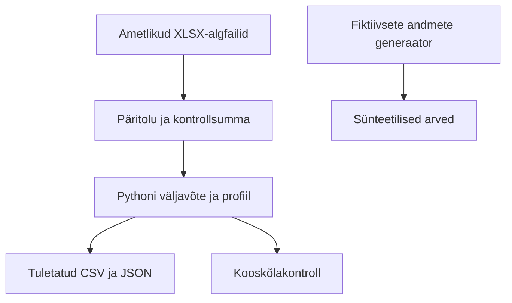

> **Uuendus 0.2:** teine etapp on teostatud. Allolev tekst säilitab esimese etapi lähteolukorra. Kehtivad täiendused: [teise etapi spetsifikatsioon](ETAPP2_TEHNILINE_SPEC.md), [kasutusjuhend](KASUTUSJUHEND_ETAPP2.md) ja [tulemused](ETAPP2_TULEMUSED.md). Etapid 3–5 ootavad korraldust.

# Arhitektuur

Esimene versioon kasutab Pythonit ja faile. SQLite'i skeem on kavandatud ning testitav mälus. Tootmisandmebaasi ega veebiserverit pole.

## Otsused

1. **Algfail säilib muutmata.** Allikalahter ja kontrollsumma võimaldavad hiljem numbrit tõendada.
2. **Väike sõltuvuste hulk.** Esimeses etapis piisab openpyxl-ist; CSV, JSON, Decimal, SQLite ja testid on Pythoni standardteegis. pandas lisandub vajaduse tekkimisel.
3. **Excel on vahetusvorming.** Python teeb korduva teisenduse ja kontrolli üheselt, Excel sobib visuaalseks ülevaatuseks ja kolleegile edastamiseks. Valemeid ei arvutata praegu Excelis ümber; loetakse olemasolevaid salvestatud väärtusi.
4. **Eelarve ja täitmine eraldi.** Puudub pimesi tehtav join nime järgi. Ühildamine vajab kinnitatud mõõdikute ja versioonide vastendust.
5. **Raha sentides.** Täisarv väldib 0,1 + 0,2 tüüpi ujukomavigu. Allika algväärtus ja algühik säilivad.

## Hilisem ühendamine

Säilitada `source_id`, `record_id`, `invoice_id`, päritolu ja skeemiversioon. Etapp 2 lisab moodulid samasse `kood/` kausta ning SQL-migratsioonid, muutmata algandmeid. Etapp 3 saab kasutada kontrollitud väljavõtteid, kuid peab lisama võrdlusmetoodika. Etapp 4 loeb ettevalmistatud avalikku JSON-i GitHub Pagesis; tundlikke sisendeid sinna ei avaldata.

Pyodide on võimalik valik kasutaja kohaliku CSV töötlemiseks. Selle vajadus ja teekide ühilduvus otsustatakse 4. etapis. GitHub Actionsi ajastust praegu ei looda. Ei Dockerit, tasulist serverit ega SAP-i koopiat.
