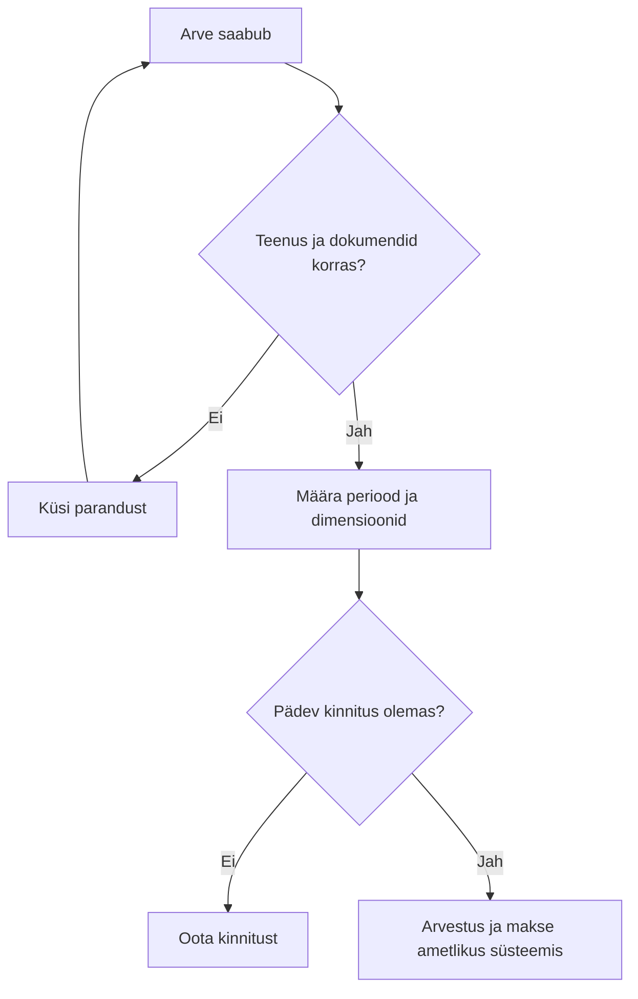

> **Uuendus 0.2:** teine etapp on teostatud. Allolev tekst säilitab esimese etapi lähteolukorra. Kehtivad täiendused: [teise etapi spetsifikatsioon](ETAPP2_TEHNILINE_SPEC.md), [kasutusjuhend](KASUTUSJUHEND_ETAPP2.md) ja [tulemused](ETAPP2_TULEMUSED.md). Etapid 3–5 ootavad korraldust.

# Tööprotsessid ja süsteemid

## Avalikest allikatest kinnitatud raamistik

RTK kirjeldab jagatud teenust: asutus annab tehinguinfo, RTK korraldab selle alusel arvestust, makseid, maksuarvestust ja aruandlust. Täpne tööjaotus sõltub toimemudelist. Kasutatakse SAP-i ning toetavate süsteemidena BusinessObjectsi, RTIP-i ja e-arvete menetluskeskkonda. RTK lehe e-arvete link suunab FitekIN-i. [RTK teenuse kirjeldus](https://www.rtk.ee/finantsarvestus-personaliteenus/arvestusteenused/finantsarvestus), kontrollitud 5.11.2026.

HTM avaldab programmid ja tulemusaruanded; eelarveinfo juurde suunab ministeeriumi leht Rahandusministeeriumi veebilehele. [HTM strateegilised dokumendid](https://hm.ee/ministeerium-uudised-ja-kontakt/ministeerium/strateegilised-alusdokumendid-ja-programmid).

## Õppeprojekti tööjaotus (simulatsioon)

| Tegevus | Asutuse finantsekspert ja sisu eest vastutaja | Keskne arvestusteenus |
|---|---|---|
| Teenuse vastuvõtt | Kinnitab, et teenus saadi ja dokument on põhjendatud | Vajadusel küsib täpsustusi |
| Arve eeltöö | Kontrollib lepingut, perioodi, eelarveallikat ja dimensioone | Kontrollib arvestuseks vajalikku infot |
| Kajastamine | Annab korrektse lähteinfo | Kajastab raamatupidamises |
| Makse | Kinnitaja teeb oma pädevuse piires otsuse | Teostab makse vastavalt kokkulepitud korrale |
| Perioodi lõpp | Selgitab puuduvaid dokumente ja hälbeid | Koostab arvestusaruanded ja kontrollib saldosid |

See tabel on õppeotstarbeline lihtsustus. HTM-i kinnitajate nimed, õigused, tähtaegade SLA ja sisemine toimemudel ei ole kontrollitud.

## Süsteemide rollide kaart

| Süsteem | Ülesanne õppeprojekti mudelis | Andmed | Pythoniga tehtav kõrvaltegevus |
|---|---|---|---|
| SAP | Raamatupidamise põhiarvestus | Kanded, kontod, dimensioonid, nõuded ja kohustised | Lubatud ekspordi kvaliteedikontroll |
| SAP BusinessObjects | Aruannete pärimine ja kuvamine | Koondid ja arvestusaruanded | Eksportide võrdlemine |
| RTIP | Töötajaga seotud iseteenindus | Nt kuludokumendi lähteinfo vastava teenuse raames | Õppeprojektis ainult fiktiivne sisend |
| FitekIN | Ostuarvete menetlus | Arve, kinnitus ja jaotus | Koopia matemaatilised ja struktuursed kontrollid |
| E-toetus / SFOS | Toetuste taotlemise ja haldamise keskkonnad | Taotlus, projekt, aruandlus | Hilisem sünteetiline toetuse juhtum |

E-toetuse ja SFOS-i viited on RTK veebis olemas; see ei tõenda, millist lahendust kasutab iga konkreetne HTM-i toetusmeede. Süsteemide vaheline tegelik API ega tabeliskeem ei ole siin teada.

## Näidisprotsessi otsustuskoht

Selles etapis kirjeldatakse protsessi; seda ei käivitata. Python võib ette valmistada vealoendi, kuid tegelikud kinnitused, maksed ja ametliku registri muudatused jäävad ametlikku infosüsteemi.

Töökuulutuse ülesannete seos: dokumentide menetlemine → arve mudel; RTK koostöö → tööjaotus; süsteemi juurutamine → nõuded ja testid; kulude analüüs → päritoluga väljavõtted; teenistujate nõustamine → õppemoodul. Ülesanded pärinevad kasutaja antud kirjeldusest.

RTIP-i avalik kirjeldus kinnitab, et portaalis kooskõlastatud andmed liiguvad SAP-i. Näiteks saab töötaja esitada lähetuse kuluaruande või majanduskulu hüvitamise taotluse. [RTIP-i kirjeldus](https://www.rtk.ee/riigitootaja-iseteenindusportaal). See on avalikult kinnitatud üldine andmevoog, mitte meie loodud liides.
