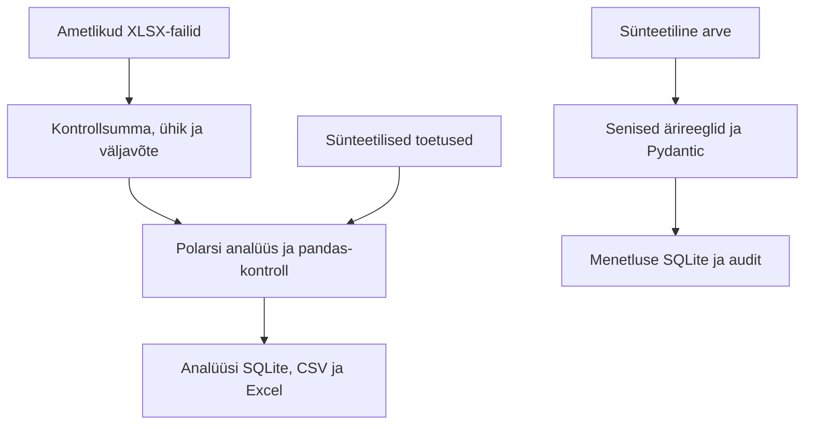

# Arhitektuur · 0.3

Kohalik Python-rakendus, kolm järjestikku valminud etappi. Arvutused käivituvad Thonnys, käsureal või Colabis. Veebiserverit, LLM-i, RAG-i ega välise süsteemi kirjutusliidest pole loodud.

| Kiht | Fail / leping | Vastutus |
|---|---|---|
| Päritolu | `andmed/allikaregister.json` | URL, SHA-256, ühik, periood, algfail |
| Allikate lugemine | `kood/etapp1.py` | Säilitatud etapi 1 väljavõtted ja kontrollid |
| Menetlus | `kood/menetlus.py` | Ärireeglid, rollid, duplikaadid, üleminekud, tehingud |
| Tüübid | `kood/andmeleping.py` | Pydantic v2; CSV sentide ja ISO kuupäevade teadlik teisendus |
| Analüüs | `kood/analuus.py` | Eelarve, kuud, aastavõrdlus, toetused, SQL väljund |
| Aruandlus | `kood/etapp3_demo.py` | Korratav käivitus, CSV/JSON/MD/XLSX, võrdlusmõõtmine |

## Tagasiühilduvus

Toor-JSON-i ei normaliseerita ega kirjutata üle. Kõik vanad ärireeglid täidetakse enne tüübitud piiri. Kui on juba blokeeriv viga, ei lisata dubleerivaid Pydanticu vigu; muidu lisab skeem rikkumisel `ANDMEKUJU`. Seetõttu võib varem märkamata vigane tüüp nüüd blokeeruda, kuid senised kehtivad näidised ja veakoodid säilivad. `extra='allow'` säilitab lisaveerud. Mudeli `frozen=True` kaitseb mudeli väljade omistamist, mitte andmebaasi ega kõigi lisaväljade süvamuutmist.

Menetluse skeem 0.2, payload 0.2 ja CLI säilivad. Kontrollireegli versioon 0.2.1 salvestub uutesse kontrollkäikudesse. Analüüsi eraldi SQLite 0.3 on iga jooksu loodav tuletis: ei kahjusta menetluse andmebaasi ega nõua vanade DB-de migratsiooni. `004_analuus.sql` käib ainult uude aruandeandmebaasi.

## Arvutusotsused

Rahad on Pythonis ja SQL-is täisarvulised eurosendid; käibemaks/toetus ümardatakse Decimal HALF_UP abil. Polars kasutab Int64, pandas nullable Int64. Protsendid on ujukomaarvulised suhtarvud; nende ümardus on esitlus. XLSX teisendab sendid eurodeks üksnes aruande kuvamisel; täpsed sendid jäävad CSV/SQL-i.

Eelarve aasta ja täitmise lõppkuu on eraldi väljad. Sama rea eelarve/täitmise võrdlus ei ole kuupõhine plaanihälve. Septembri kuluvaadet ei ühendata augusti eelarvevaatega. Koondread, asutused ja rahastusristlõiked on eristatud; koondit ja detaile ei liideta kokku.

## Hilisem ühendamine

Säilitada source_id, dokumendi ID, periood, mõõdik, päritolu, reegli- ja skeemiversioon. Tulevane API võib kutsuda sama Pydanticu mudelit ja teenusefunktsioone. Analüüs kasutab ainult kinnitatud/kajastatud menetlusandmeid, kui selline ühendus hiljem lisatakse; praegune aruanne ei loe kontrollimata arveid tegelikeks kuludeks. Veeb, ML, LLM ja RAG on tulevikuvõimalused, mitte selle etapi teostus.
