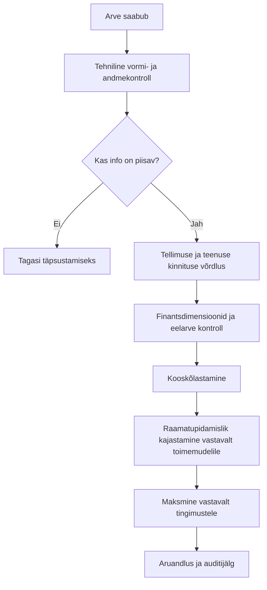

# 03. Ostuarve kontroll ja menetlus

## Õppimisjuhtum

Fiktiivne „Haridusamet X“ tellib IT-hoolduse. Tarnija esitab arve: alus 1000 €, 24% käibemaks 240 €, kokku 1240 €.

**Lihtsustatud protsess:**



See on **õppemudel**, mitte RTK või HTM-i sisemise menetluskeskkonna ametlik kirjeldus.

## Milliseid andmeid kontrollida?

| Kontroll | Näide | Võimalik leid |
|---|---|---|
| Arve identifikaator | Arve nr + tarnija | Sama arve võib olla korduvalt sisestatud |
| Tarnija | Äriregistri tunnus / lepingupartner | Arvel ja lepingus erinev tarnija |
| Kuupäevad | Arve kuupäev, teenuse periood, tähtaeg | Teenus ja arve eri kuudes |
| Summa | Neto + KM = bruto | Aritmeetiline viga |
| KM määr ja alus | Tehingu liigile kohane | Vale määra kahtlus, vaja täiendavat kontrolli |
| Ostutellimus/leping | Hind ja kogus | Arve ületab kokkulepet |
| Teenuse vastuvõtt | Üksus kinnitab töö tegemise | Puudub teenuse osutamise tõend |
| Kulukoht / finantsdimensioon | IT-teenused | Vale kululiigitus |
| Eelarve | Vastav periood ja kululiik | Eelarves ei pruugi olla piisavalt vahendeid |
| Auditijälg | Kes, millal, mis alusel kinnitas | Puudub menetluse põhjendus |

**Erand:** kõiki välju ei saa universaalse automaatreegliga lõplikult otsustada; osad nõuavad lepingute, maksureeglite, dokumentide ja toimemudeli tõlgendamist.

## Finantseksperdi põhiotsused

- **Kinnitan kontrolltulemuse:** andmed klapivad ja menetlus saab jätkuda vastavalt pädevusele.
- **Saadan täpsustamiseks:** arve või kululiigi kohta puudub piisav info.
- **Eskaleerin:** ilmneb võimalik lepingu-, õigusliku või arvestuspõhimõtte probleem.
- **Dokumenteerin:** jätan kirje, milline kontroll ja otsus tehti.

## Vigade näited

1. `INV-101` ja `INV-101` sama tarnija juures – võimalik duplikaat.
2. 1000 € + 240 € KM, aga kokku 1250 € – summade mittevastavus.
3. Kulu märgitud detsembrisse, kuigi teenus osutati novembris – võimalik perioodiviga.
4. Puudub kulukoht – ei ole selge, kelle eelarvesse kulu kuulub.
5. Arve on 60 päeva üle tähtaja, kuid staatus näitab „ootab“ – vaja uurida, mitte automaatselt tasuda.

## Kuidas sinu IT-kogemus siia sobib?

Kirjelda kontrolli nagu testi:

```text
Nõue: netto + käibemaks = arve summa (sentides ümardatult).
Sisend: 1000.00; 240.00; 1250.00.
Oodatud tulemus: MITTEVASTAVUS 10.00 €.
Tegelik tulemus: kontrollimootor peaks tagastama põhjendatud veateate.
```

See on otsene seos tarkvaratestimise ja finantsarvestuse andmekvaliteedi vahel.

## Suuline harjutus

„Mida teeksite, kui arvel on õige summa, aga puudub kulukoht ja teenuse vastuvõtmise kinnitus?“

**Soovituslik vastus:** ei järeldaks ainult summa põhjal arve korrektsust; küsiks vajaliku finantsinfo ja kinnituse, fikseeriks kontrolli ning jätkaks vastavalt asutuse toimemudelile.
