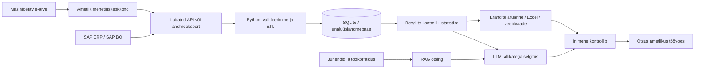

# 09. Praktilise finantsarvestuse tulevikutehnoloogiad

**Praktilise finantsarvestuse eelkursuse järg**  
**Versioon:** 1.0 · 05.11.2026  
**Sihtrühm:** finantsarvestuse eksperdi ametikohale valmistuv analüütilise ja IT-taustaga õppija  
**Õppeaeg:** ligikaudu 2–3 tundi koos mõtteharjutustega  
**Märkus:** sõltumatu õppematerjal; see ei kirjelda HTM-i ega RTK kinnitatud arendusplaane.

> **Põhiidee:** tulevik ei ole „SAP kaob ja LLM teeb kogu raamatupidamise“. Paljudel juhtudel jääb SAP ametlikuks arvestussüsteemiks (*system of record*), kuid selle kõrval töötavad paremad andmeliidesed, Pythoni kontrollid, automaatne analüüs, dokumentide otsing (RAG) ja inimesele otsustusabi pakkuv AI. Kontrollitavad arvutused ja kinnitused peavad jääma jälgitavaks.

## Õpiväljundid

Pärast läbimist oskad:

1. võrrelda käsitsi tehtavat, reeglipõhist ja AI-toega finantsarvestust;
2. selgitada, mida ERP/SAP, e-arved, RTIP, SAP BO, API ja andmeladu igaüks teeb;
3. kirjeldada, kuidas Python, SQL, ML, LLM ja RAG neid lahendusi täiendavad;
4. kavandada ühe turvalise väikese automaatikapiloodi;
5. hinnata piloodi kasu, valepositiivseid tulemusi ja tehnilisi riske;
6. tutvustada uuendusettepanekut töövestlusel ilma kogemust või õigusi üle väitmata.

---

## 1. Miks muutused on vajalikud ja millised ei ole vältimatud?

**Põhjused:**

- Majandustehinguid on palju; korduv andmete ümbertrükkimine kasvatab töökoormust ja vigade riski.
- Töötajad vajavad kiiresti vastuseid: miks eelarverida on muutunud ja millised arved seda mõjutavad?
- Juhtimine eeldab ajakohast, võrreldavat ja selgitatavat aruandlust.
- Kontrollijad peavad nägema, millistest allikatest järeldused saadi, kes tehingu kinnitas ja mida tarkvara muutis.
- Andmevahetuse standardid (näiteks masinloetavad e-arved) loovad võimaluse automatiseerida tööd ilma iga arvet käsitsi sisestamata.
- Tehnoloogiline võimekus ja ootused muutuvad; **kuid konkreetne tööriist või AI-lahendus ei ole iseenesest vältimatu**. Iga juurutus peab olema majanduslikult, õiguslikult ja töökorralduslikult põhjendatud.

**Näide (illustratiivne, mitte RTK mõõdik):** asutus töötleb kuus 1 000 ostuarvet. Kui lihtne lisakontroll vähendab inimese käsitsitööd keskmiselt 2 minutit arve kohta, säästetakse 2 000 minutit ehk umbes 33,3 töötundi kuus. Säästu realiseerumine sõltub aga vigadest, eranditest, juurutusest, hooldusest ja tegelikust töökorraldusest.

**Oluline eristus:** automatiseerimine **vähendab** rutiini, kuid ei kaota vajadust õigete kontode, pädevuse, sisulise kontrolli ja vastutuse järele.

### 1.1 Evolutsioon, mitte maagiline asendamine

| Töö | Tänane tüüpiline lahendus | Võimalik järgmine samm | Mis jääb inimese või ametliku süsteemi kanda? |
|---|---|---|---|
| Ostuarve andmete sisestus | Masinloetav e-arve või käsitsi sisestus | Automaatne import, valideerimine ja erandite suunamine | Arve sisuline kinnitamine, volitused |
| Arvete kontroll | Menetluskeskkonna kontrollid, käsitsi ülevaatus | Pythoniga täiendavad kontrollireeglid, ML erandimärguanded | Kahtlase arve sisuline uurimine |
| Aruandlus | SAP BO, Excel | Pythoni andmetoru + korduvkasutatav veebitöölaud | Aruande ametlikkus ja tõlgendus |
| Dokumendiotsing | Juhendite käsitsi sirvimine | RAG, mis leiab juhendite õiged lõigud koos viitega | Kehtiva õigusakti tõlgendamine |
| Kulude prognoos | Aastased võrdlused ja ekspertotsus | Statistiline prognoos + stsenaariumid | Eelarveotsused ja eelduste põhjendamine |
| Integratsioon | Failiimport/eksport | API, sõnumijärjekord või ajastatud eksport | Turvaline juurdepääs, ametlikud kanded |

**Tähtis:** riigi arvestuse põhisüsteemide väljavahetamise vajadus ja ajakava ei tulene sellest tabelist. Tabel on võimalike arendussuundade analüüs.

---

## 2. Tänased süsteemid: mida täpselt täiendame?

RTK kirjeldab riigi finantsarvestuses SAP-i ning sellega seotud aruandlus- ja menetlussüsteeme; süsteemide ja asutuste tööjaotus sõltub konkreetsest toimemudelist ([RTK finantsarvestuse teenus](https://www.rtk.ee/finantsarvestus-personaliteenus/arvestusteenused/finantsarvestus)).

| Süsteem / vahend | Põhieesmärk | Kuidas tulevikulahendus haakub? |
|---|---|---|
| **SAP (ERP)** | Majandustehingute arvestus ja ametlikud andmed | Lubatud andmeväljavõte või API → Python kontrollib → kinnitatud töövoog, vajadusel tagasiside ametliku liidese kaudu |
| **SAP Business Objects** | Ametlikest andmetest aruandlus | SAP BO aruanded CSV/XLSX-kujul → pandas → täiendav analüüs; vajadusel standardiseeritud liides |
| **RTIP** | Riigitöötaja iseteeninduse protsessid | Lubatud integratsioonide puhul staatused, viited või andmevahetus; demo kasutab **simuleeritud** staatuseid |
| **E-arvete menetluskeskkond** | Arvete vastuvõtt, kontroll ja menetlemine | Masinloetav arve → kontrollireeglid → erandite ülevaatamise järjekord |
| **Excel** | Andmete ülevaatamine, võrdlemine ja jagamine | Python loeb, valideerib ja loob XLSX-aruande; Excel jääb mugavaks väljundiks |
| **SQL-andmebaas** | Kontrollitav struktureeritud andmestik | Ühine analüüsi- ja kontrollikiht, päringud, ajalugu, selged võtmed |
| **LLM/RAG** | Teksti selgitamine ja dokumentidest vastuste leidmine | Viidetega abi; **ei tohi** asendada arvutusmootorit ega õigustatud kinnitajat |

Eesti e-arve on **struktureeritud masinloetav fail**, mitte lihtsalt e-postiga saadetud PDF. Eestis kasutatakse nii kohalikku kui ka Euroopa e-arve standardit. Rahandusministeeriumi selgituse järgi kehtib 2025. aastast ostjapõhine e-arve nõudmise korraldus (vt täpseid tingimusi seadusest ja [Rahandusministeeriumi juhendist](https://www.fin.ee/finantspoliitika-valissuhted/arvestusvaldkond/raamatupidamise-algdokumendid-arved-e-arved)). Seega tuleb aegunud väidet „kõigile avaliku sektori ostjatele alati automaatselt kohustuslik“ kontrollida kehtiva teksti järgi.

### 2.1 Üks arve kolmes põlvkonnas

**Minevik:** arve saabub PDF-ina → töötaja tipib numbrid → kontrollib kalkulaatoriga → sisestab süsteemi → koostab Exceli kokkuvõtte.

**Tänane digitaliseeritud praktika:** masinloetav e-arve → menetlussüsteem loeb summad ja väljad → töötaja kontrollib sisulist põhjendatust → ERP kajastab tehingu → aruandlus kuvab tulemuse.

**Võimalik järgmine etapp:** e-arve → automaatne formaadi- ja summakontroll → ostutellimuse/lepingurea seostamine → erandite tuvastus → vajadusel ML-i riskijärjestus → inimene lahendab erandid → ametliku süsteemi töövoog jätkub → automaatne aruandlus.

Tähtis: **ML-i „ebatavaline“ ei tähenda „pettus“** ning arve automaatne klassifitseerimine ei tähenda, et kirjendamine oleks juba heaks kiidetud.

---

## 3. Tulevikutehnoloogiate praktiline roll

### 3.1 Python: esimene ja kõige mõistlikum samm

Python sobib eriti hästi korduvatele ja kontrollitavatele tegevustele:

- failide import: CSV, XLSX, JSON, XML;
- andmete puhastamine: nimed, kuupäevad, valuutad, kulukeskused;
- matemaatilised kontrollid: netosumma + käibemaks = kogusumma;
- automaatsed aruanded: tabelid, graafikud, mitmelehelised Exceli failid;
- andmekvaliteedi kontrollid: duplikaadid, puuduolevad väärtused, vigased koodid;
- API-de kasutamine (kui vastava süsteemi liides ja õigused on olemas);
- auditijälg: millise versiooni ja andmestikuga kontroll käivitati.

**Näide:** 500 rea pikkune Exceli fail ei vaja uue ERP-i ostmist. Python saab 15 kontrollireeglit käivitada ühtemoodi igal kuul ja anda erandite nimekirja.

Finantsarvestuse täpsuse jaoks hoia summasid sentides täisarvudena või kasuta Pythoni `Decimal`-tüüpi. Ära kasuta põhilises arvestusloogikas binaarset `float`-arvutust.

### 3.2 SQL ja andmeladu: üks kontrollitav andmebaas

SQL-i eesmärk ei ole SAP-i asendada. Analüüsi jaoks saab koguda **lubatud väljavõtted**, märkida allika ja kuupäeva ning hoida neid eraldi analüüsiandmebaasis.

Võimalik väikese piloodi skeem:

```text
source_file(id, failinimi, periood, impordiaeg, sha256)
invoice(id, arve_nr, tarnija, netosendid, kmsendid, kogusendid, kulukeskus, source_id)
control_result(id, arve_id, reegel, tulemus, selgitus, kontrolli_aeg)
review(id, arve_id, otsus, otsustaja_roll, otsuse_aeg)
```

Miks tasub iga kirje allikas alles hoida? Et audit või kolleeg saaks aru, **kust number tuli**, mitte ainult milline arvutus seda viimati kasutas.

### 3.3 RPA: hiireklikkide automatiseerimine

**Robotic Process Automation** teeb kasutajaliideses tegevusi, mida inimene muidu klõpsaks ja kopeeriks.

- **Kasulik:** vanal süsteemil ei ole API-t ja tuleb automatiseerida rutiinset, stabiilset tegevust.
- **Nõrkus:** kasutajaliidese muutused võivad roboti katki teha; kontroll ja logimine on keerulisemad.
- **Eelistus:** kui turvaline ametlik API või ekspordiliides on olemas, kasuta seda pigem kui ekraanil klõpsivat robotit.

Ära kasuta RPA-d õiguste või kinnitusringide möödahiilimiseks.

### 3.4 Andmeteadus ja statistika

Enne masinõpet annavad palju väärtust lihtsad mõõdikud:

- kulu muutus kuust kuusse;
- 5 suurimat kulukeskust;
- arve menetlemise mediaanaeg;
- võimalike duplikaatide arv;
- osakaal arvetest, mis vajavad käsitsi ülevaatust;
- eelarve täitmise prognoos, mille eeldused on nähtavad.

**Näide:** jaanuarist septembrini on ühe tegevuse kulu 90 000 eurot. Lihtne üheksa kuu keskmisele tuginev aastaprojektsioon on `90 000 / 9 × 12 = 120 000 €`. See pole usaldusväärne, kui kulud on sesoonsed või aasta lõpus tehakse suuremad ostud. Andmeanalüütik peab prognoosi piirangud välja ütlema.

### 3.5 Masinõpe (ML): erandite järjestamine

Masinõpe on kasulik siis, kui fikseeritud reeglid ei avasta kogu mustrit või erandeid on liiga palju.

| Juhtum | Sobiv algmeetod | Mida vältida? |
|---|---|---|
| Uus arve on tavapärasest palju suurem | Mediaan, kvantiil, robustne z-skoor | „Suur arve = vale arve“ |
| Ebatüüpiline kombinatsioon: tarnija + kulukeskus + summa | Isolation Forest või muu kõrvalekallete meetod | Ilma kontrollandmeteta automaatne blokeerimine |
| Arve liigitamine kulukeskusele | Reeglid, vajadusel juhendatud klassifikatsioon | Vigaste ajalooliste siltide pimesi õppimine |
| Lähikuude kulude prognoos | Hooajalisuse mudel, baasprognoos, hiljem ML | Mudeli hea väljanägemise segiajamine tuleviku täpsusega |

**Hea tööjärjestus:** lihtne kontrollreegel → võrdlusbaas → märgistatud näited → ML-mudel → katsetamine → mõõda täpsust ja valepositiivseid. Üksikuid sünteetilisi anomaaliaid avastav mudel ei tõesta mudeli toimimist päris finantskeskkonnas.

Kui 1 000 arvete hulgast on tegelikke probleeme ainult 10, võib ka suhteliselt hea mudel teha palju valehäireid. Mõõda *precision* (kui suur osa leitud juhtudest oli probleem), *recall* (kui suur osa probleemidest leiti) ja ülevaatamise ajakulu.

### 3.6 LLM: keel ja selgitused, mitte raamatupidamislik tõde

LLM sobib näiteks:

- veateadete selgitamiseks lihtsas eesti keeles;
- juhendi lõigu ümberjutustamiseks;
- SQL-päringu mustandi kirjutamiseks;
- aruande teksti esimese variandi koostamiseks;
- küsimuse „miks see kulukeskus kasvas?“ jaoks tööversiooni pakkumiseks.

**Ära lase LLM-il üksi** arvutada bilanssi, kinnitada arveid, teha makseid, muuta SAP-i kandeid ega otsustada seaduse tähenduse üle.

Näide turvalisest tööjaotusest:

```text
Pandas/SQL arvutavad: IT-kulud kasvasid 11,8%.
LLM kirjutab: „IT-kulud suurenesid võrreldes eelmise perioodiga 11,8%.“
Inimene kontrollib: kas perioodid on võrreldavad? kas tõus oli põhjendatud?
```

Kui LLM väidab „kasvu põhjustas serverite ost“, peab väide olema seotud tegeliku tõendusmaterjaliga; lihtsalt arvude põhjal seda järeldada ei saa.

### 3.7 RAG: AI, kes otsib enne vastamist dokumentidest

**RAG** (*retrieval-augmented generation*) tähendab ligikaudu järgmist:

1. Kasutaja küsib: „Milliseid andmeid pean ostuarvel kontrollima?“
2. Otsing otsib asjakohased lõigud lubatud ja ajakohastest juhenditest.
3. Lõigud koos allika, versiooni ja kuupäevaga lisatakse LLM-i päringule.
4. LLM koostab vastuse **ainult leitud tõendusmaterjalile tuginedes** ja näitab viiteid.
5. Kasutaja kontrollib allikad ja teeb pädeva otsuse.

Erinevus tavalisest vestlusrobotist: RAG võimaldab vastata konkreetse organisatsiooni dokumentide alusel ning teha vastuse kontrollitavamaks. **RAG ei välista hallutsinatsioone.** Kui allikat ei leita, peab süsteem oskama öelda „Ma ei leidnud piisavat teavet“.

#### Kas vajame vektorandmebaasi?

**Ei pea alustama.** Väikese 20–50 dokumendiga labori jaoks sobivad lihtne märksõnaotsing või SQLite FTS5. Suuremate ja mitmekesisemate dokumentide korral võib lisada embedding'ud ja vektorotsingu (nt Chroma). Esmalt tuleb mõõta, kas otsing leiab õiged lõigud ja kas vastus viitab õigetele versioonidele.

**RAG ei ole dokumentide sisestamine LLM-i mällu.** Tegemist on päringu ajal asjakohase teabe leidmisega. Vaata [Microsofti RAG-selgitust](https://learn.microsoft.com/en-us/azure/foundry/concepts/retrieval-augmented-generation).

### 3.8 AI-agendid: järgmine aste, aga mitte esimene projekt

Agent võib planeerida mitmest osast koosnevat protsessi:

- vaata viimast aruannet;
- kontrolli kõrvalekalded;
- otsi juhendi nõuded;
- koosta ülevaade;
- küsi inimeselt kinnitust enne avaldamist.

Agent on kasulik **siis, kui on mitu tööriista ja otsustussammu**. Üksainus `pandas.groupby()` ei vaja agenti. Piira agendi õigused algul lugemise ja mustandi koostamisega. Rahaliikumise, ametliku kande või dokumendi kinnitamise õigus ei sobi vabalt tegutsevale agentile.

---

## 4. Kuidas uus tehnoloogia vana süsteemiga päriselt suhtleb?

### 4.1 Tüüpiline arhitektuur (soovitatav piloot)



Diagramm on **õppedemona kavandatav arhitektuur**, mitte päris HTM-i tehniline skeem.

### 4.2 Liideste valiku järjekord

1. **Ametlik API** (REST/OData), kui olemas, dokumenteeritud ja asutusel lubatud.
2. **Ametlik ekspordi-/impordifunktsioon** (CSV/XLSX/XML), kui API-t ei saa kasutada.
3. **Ajastatud koopia või andmeladu**, kui asutusel on selline turvaline protsess.
4. **RPA** ainult kontrollitud, põhjendatud erandina.
5. **Käsitsi demonstratsioon** sünteetiliste andmetega, kui pärissüsteemile ligipääsu pole.

SAP-i tootepere dokumentatsioon tunneb OData ja muid API-sid ([SAP-i API juhend](https://help.sap.com/docs/SAP_S4HANA_ON-PREMISE/2628c891a3a04f05a293c7ca5d23e4b6/1e60f14bdc224c2c975c8fa8bcfd7f3f.html?locale=en-US)), kuid **see ei tõenda**, et Eestis kasutatava konkreetse SAP-i juurutuse jaoks oleks sama liides lubatud või avatud.

### 4.3 Liidestuse kontrollküsimused

Enne ühegi pärissüsteemi andmete liigutamist uuri:

- Kas süsteemil on ametlik liides või eksport?
- Kes on andmete omanik ja kes võib neid kasutada?
- Millised väljad on vajalikud (andmete minimaalsus)?
- Kas info sisaldab isikuandmeid või muud piiratud teavet?
- Milline on tehingu identifikaator? Kuidas väldime topeltimporti?
- Kuidas märgistame versiooni ja allikafaili?
- Mida teeme võrguvea, vigase faili või osalise impordi korral?
- Kas andmed liiguvad ainult lugemiseks või on plaanis kirjutada ka ametlikku süsteemi?
- Kes on kinnitaja ja kuidas säilib auditijälg?

### 4.4 Konkreetne JSON-vahetuse näide

Ühes **sünteetilises** piloodis võib menetluskeskkond väljastada järgmise kirje:

```json
{
  "arve_id": "ARV-101",
  "tarnija": "Naidis IT OU",
  "arve_nr": "2026-101",
  "neto_senti": 100000,
  "km_senti": 24000,
  "kokku_senti": 124000,
  "kulukeskus": "IT",
  "staatus": "MENETLEMISEL"
}
```

Python kontrollib: `100000 + 24000 == 124000`. See on formaalne aritmeetiline kontroll; see **ei tõenda** lepingu olemasolu ega seda, et sisendkäibemaks on mahaarvatav.

Pärast kontrolli luuakse eraldi *kontrollitulemus*:

```json
{
  "arve_id": "ARV-101",
  "kontroll": "SUMMA_KLAPIB",
  "tulemus": "OK",
  "kontrollija": "python-demo-1.0"
}
```

**Põhimõte:** kontrollimootor ei kirjuta ametlikku pearaamatusse uusi kandeid. Ta annab ametliku menetluse kasutajale kontrollitavat lisainfot.

---

## 5. Kolm moderniseerimisprojekti, mida saad ise alustada

### Projekt A. „Arvete erandikontroll“ – esimene nädal

**Äriprobleem:** suure arvetabeli käsitsi ülevaatamine on tüütu ning vigased read võivad märkamata jääda.

**Sisend:** lubatud eksport või sünteetiline CSV/JSON.

**Python:** kontrollib summad, korduvad arvenumbrid, puuduva kulukeskuse, kuupäevad, kohustuslikud väljad.

**Väljund:** Exceli erandite aruanne ja SQLite'i logi.

**Mõõdikud:** kontrollitud arvete arv, avastatud vigade arv, valepositiivsete arv, käsitsi ülevaatamise aeg.

**Eelis:** töötab ilma LLM-ita, on selgitatav ja sobib kiiresti demonstreerimiseks.

### Projekt B. „Eelarve muutuste radari“ – teine nädal

**Äriprobleem:** kulusid ja eelarvet vaadatakse sageli kokkuvõttest, aga kõrvalekalde põhjus ei selgu kohe.

**Sisend:** päris avalikud eelarve täitmise koondandmed või asutusesisesed lubatud väljavõtted.

**Python + SQL:** arvutab hälbe ja trendi, märgib kiiresti kasvavad read.

**ML (valikuline):** reastab ebatavalised muutused, mitte ei nimeta neid vigadeks.

**LLM (valikuline):** kirjutab deterministlikult arvutatud näitajate põhjal kokkuvõtte, mille inimene üle vaatab.

**Tähtis:** ajavahemik, ühikud ja arvestusmeetod peavad olema võrreldavad; päris avalikke koondandmeid ei tohi segada fiktiivsete arvetega.

### Projekt C. „Finantsjuhendi assistent“ – kolmas nädal

**Äriprobleem:** uus töötaja otsib sama infot mitmest määrusest, juhendist ja protsessikirjeldusest.

**Sisend:** avalikud või asutuse poolt lubatud juhendid, metaandmed ja versioonid.

**Otsing:** esmalt SQLite FTS või lihtne tekstotsing; vajadusel embedding'ud ja Chroma.

**LLM/RAG:** vastab dokumendiviidetega; küsib täpsustusi, kui olukord sõltub asjaoludest.

**Edu kriteerium:** näitab õiget juhendilõiku ja kehtivuse kuupäeva; ei mõtle välja norme.

**Turvalisus:** konfidentsiaalseid andmeid ei tohi avalikku LLM-teenusesse edastada ilma asutuse loata ja nõuetekohaste kaitsemeetmeteta.

---

## 6. Milline tehnoloogia asendab mida?

| Tänane võte | Võimalik asendus / täiendus | Kas saab täielikult ära jätta? |
|---|---|---|
| Käsitsi CSV-de ühendamine Excelis | `pandas.merge()` / SQL `JOIN` | Sageli jah, kui allikad on korrektsed |
| Korduvad Exceli valemid | Pythoni testitav arvutusmoodul | Sageli jah; Excel võib jääda vaateks |
| Arvete rutiinne silmaga võrdlemine | Reeglite kontroll, duplikaadiotsing | Osaliselt; sisulised erandid jäävad |
| PDF-ist arvenumbrite ümberkirjutamine | E-arve XML / dokumentide struktureeritud lugemine | Suures osas, kui e-arve on olemas |
| Käsitsi aruannete kopeerimine | Ajastatud Python + kinnitatud aruandemall | Suures osas |
| Juhendi käsitsi otsimine | RAG koos korrektsete viidetega | Otsimist saab vähendada, otsust ei asenda |
| SAP BO aruandlus | Täiendav Python/veebitöölaud | Mitte tingimata; ametlik aruandlus võib jääda |
| SAP ERP | Kaasaegne ERP või sügavamad integratsioonid | Mitte väikeprojekti otsus; sõltub asutusest |
| Inimese finantsotsus | AI-põhine otsustusabi | **Ei** – vastutus ja heakskiit on vajalikud |

Seega ei pea „moodsam“ tähendama **asendamist**. Sageli tähendab see töövoo kindlamaks ja mõõdetavamaks muutmist.

---

## 7. Ohutus, õiguslik raam ja kvaliteet

### 7.1 Andmekaitse ja avalik sektor

- Andmekaitse üldmäärus (IKÜM/GDPR) jääb kehtima ka AI kasutamisel ([AKI selgitus](https://www.aki.ee/tehisaru/tehisaru-ja-andmekaitse/isikuandmete-kaitse)).
- Eesti infoturbestandard E-ITS annab avalike ülesannete täitmisel infoturbe raamistikku ([RIA E-ITS](https://ria.ee/kuberturvalisus/riigi-infoturbe-meetmete-haldus/eesti-infoturbestandard-e-its)).
- EL-i AI määrus rakendub etapiti; konkreetse süsteemi kohustused sõltuvad kasutusjuhtumist ja riskikategooriast ([Euroopa Komisjoni AI Act Service Desk](https://ai-act-service-desk.ec.europa.eu/en/ai-act/faq/when-does-enforcement-start)). Tavaline arvete analüüsi tööriist **ei muutu automaatselt** suure riskiga AI-süsteemiks üksnes seetõttu, et ta kasutab ML-i.

### 7.2 LLM-i ja agendi riskid

Peamised probleemid on väljamõeldud vastused, vale juhendiversioon, dokumendist pärinev juhiste süstimine (*prompt injection*), üleliigsed õigused, isikuandmete lekkimine ja põhjendamatult suur usaldus mudeli vastu. Vt [OWASP LLM Top 10 (2025)](https://genai.owasp.org/llm-top-10/) ja [NIST GenAI riskiprofiil](https://www.nist.gov/publications/artificial-intelligence-risk-management-framework-generative-artificial-intelligence).

**Minimaalsed kontrollid piloodis:**

1. ainult avalikud või sünteetilised andmed;
2. lugemisõigus, mitte muutmisõigus;
3. seadistatud juurdepääs ja andmete minimaalne maht;
4. valideeritud väljund ja automaattestid;
5. allikaviited ja logi;
6. inimene kontrollib enne otsust;
7. võimalus lahendus välja lülitada ja käsitsi jätkata.

### 7.3 Mudeli testimine

Enne ML- või RAG-lahenduse kasutuselevõttu loo testkogum:

- 20–50 korrektset ja vigast näidisarvet (osad ette teada);
- küsimused, millele juhend annab vastuse;
- küsimused, mille kohta juhend **ei** anna vastust;
- muutunud juhendiversioon;
- eksitav või pahatahtlik dokumendis sisalduv juhis;
- 2 erinevat sama tüüpi arvet, millel on ebatavaline, kuid õigustatud kulu.

**Süsteem peab oskama eksida ohutult:** põhjendama, milline kontroll ebaõnnestus, ja vajadusel saatma juhtumi inimesele.

---

## 8. Kuidas sina võiksid uuendusi päriselus algatada?

Ära alusta lausega „võtame SAP-i asemel AI“. Alusta konkreetse probleemiga.

### 8.1 Väikese juurutuse kuus sammu

1. **Küsi probleemi:** „Milline korduv finantsarvestuse tegevus võtab palju aega ja millised vead seal tekivad?“
2. **Mõõda lähteolukord:** näiteks 100 arve käsitsi kontrollimise aeg ja leitud vead.
3. **Vali väike, tagasipööratav piloot:** Pythoniga ainult lugemine ja erandite aruanne.
4. **Testi sünteetiliste andmetega:** sealhulgas teadlikult vigased kirjed.
5. **Näita võrdlust:** käsitsi protsess vs automaatika; mitu viga, mitu valehäiret, kui palju aega säästeti.
6. **Alles siis paku asutusesisest kasutust:** kooskõlastus finantsvastutaja, IT, infoturbe ja andmekaitse osapooltega.

### 8.2 Üheleheküljelise muudatusettepaneku mall

```text
PROBLEEM: Ostuarvete korduv käsitsi kontrollimine.
TÄNANE PROTSESS: [mõõdetud sammud, maht ja ajakulu].
ETTEPANEK: Pythoniga kontrollireeglite piloot, ainult lugemisõigusega.
ANDMED: Sünteetilised või selleks kasutuseks lubatud ekspordid.
TURVARISKID: Andmete piirangud, ligipääs, logimine, väljundite säilitamine.
EDU MÕÕTMINE: Ajakulu, täpsus, valepositiivsed, hoolduskulu.
VASTUTUS: Inimene kinnitab kõik erandid ja ametlikud tegevused.
OTSUS: Katsetada / täiendada / mitte kasutusele võtta.
```

### 8.3 Töövestlusel sobiv lühiselgitus

> „Minu varasem kogemus on eelkõige infosüsteemide analüüsis, SQL-is ja Pythonis. Finantsarvestuse erialapraktikat pean veel õppima. Olen siiski läbi proovinud, kuidas saab arveandmeid automatiseeritult kontrollida, teha Exceli aruandeid ning kavandada RAG-põhist juhendiotsingut. Ma ei näe seda SAP-i või ametlike otsuste asendusena, vaid võimalusena vähendada käsitsitööd ja aidata spetsialistidel eranditele keskenduda.“

---

## 9. Soovitatav iseseisev õpitee (7 päeva, 60–90 min päevas)

| Päev | Fookus | Kontrollitav tulemus |
|---|---|---|
| 1 | RTK, ERP, e-arve, aruandlus | Joonistad ühe arve teekonna läbi süsteemide |
| 2 | Python + andmete kvaliteet | Käivitad reeglipõhise arvekontrolli |
| 3 | SQL + Exceli väljund | Koostad koondi ja selgitad allikaid |
| 4 | Statistika ja kulude hälbed | Tõlgendad 3 ebatavalist arvet |
| 5 | ML erandite järjestamiseks | Võrdled ML-i fikseeritud reegliga |
| 6 | RAG + LLM | Koostad ainult allikatele tugineva vastuseprompti |
| 7 | Turvalisus ja töövestlus | Esitad 3-minutilise realistliku arendusettepaneku |

Jätka praktilise juhendiga: [10_AUTOMATISEERIMISE_LABOR.md](10_AUTOMATISEERIMISE_LABOR.md). Ülesanded ja vastused: [11_TULEVIKUTEHNOLOOGIATE_HARJUTUSED.md](11_TULEVIKUTEHNOLOOGIATE_HARJUTUSED.md).

---

## 10. Allikad ja edasine lugemine

**Kontrollitud 05.11.2026.** Õigusaktide ja töökorralduse muudatuste puhul kontrolli alati ajakohast versiooni.

1. [RTK – finantsarvestuse teenus](https://www.rtk.ee/finantsarvestus-personaliteenus/arvestusteenused/finantsarvestus) — tööjaotus ja kasutatavad süsteemid.
2. [RTK – e-arved](https://www.rtk.ee/saldoandmikud-finantsnaitajad/saldoandmike-kasutajad/e-arved) — e-arvete saatmine avalikule sektorile.
3. [Rahandusministeerium – algdokumendid ja e-arved](https://www.fin.ee/finantspoliitika-valissuhted/arvestusvaldkond/raamatupidamise-algdokumendid-arved-e-arved) — masinloetavad e-arved ja kehtiva korra selgitus.
4. [SAP API-d ja integratsioon](https://developers.sap.com/integrate/) — SAP-i liidestamise võimalused toodete lõikes; mitte konkreetse HTM-i liidese olemasolu kinnitus.
5. [Microsoft – RAG-i toimimine](https://learn.microsoft.com/en-us/azure/foundry/concepts/retrieval-augmented-generation) — otsing, tõenduslõigud ja keelemudel.
6. [OWASP – LLM Top 10 (2025)](https://genai.owasp.org/llm-top-10/) — LLM-i ohud.
7. [NIST – GenAI riskijuhtimise raamistik](https://www.nist.gov/publications/artificial-intelligence-risk-management-framework-generative-artificial-intelligence).
8. [RIA – Eesti infoturbestandard](https://ria.ee/kuberturvalisus/riigi-infoturbe-meetmete-haldus/eesti-infoturbestandard-e-its).
9. [AKI – AI ja isikuandmete kaitse](https://www.aki.ee/tehisaru/tehisaru-ja-andmekaitse/isikuandmete-kaitse).
10. [Euroopa Komisjon – AI määruse kohaldamise ja järelevalve ajakava](https://ai-act-service-desk.ec.europa.eu/en/ai-act/faq/when-does-enforcement-start).
11. [RTK – finantsarvestuse ja aruandluse juhendid](https://www.rtk.ee/saldoandmikud-finantsnaitajad/saldoandmike-kasutajad/finantsarvestuse-ja-aruandluse-juhendid).

---

## 11. 15 mõistet, mille tähendust peaksid oskama selgitada

| Mõiste | Lihtne seletus |
|---|---|
| ERP | Majandustegevuse põhiprotsesse ja arvestust ühendav süsteem |
| System of record | Ametlik andmete algallikas, mille sisu on autoriteetne |
| ETL/ELT | Andmete väljavõtmine, teisendamine ja laadimine (erinevas järjekorras) |
| API | Kokkulepitud viis kahe tarkvara vahel andmeid vahetada |
| OData | Veebipõhine liideste standard, mida kasutavad muu hulgas SAP-i lahendused |
| E-arve | Masinloetav standarditud arve; mitte pelgalt PDF |
| Idempotentsus | Sama impordi kordamine ei tekita uusi topeltkirjeid |
| Auditijälg | Logi, kes mida, millal ja mille põhjal tegi |
| Andmeladu | Analüüsi jaoks koondatud, struktureeritud andmestik |
| RPA | Kasutajaliidese tegevuste automatiseerimine |
| ML | Statistiliste mustrite õppimine andmetest |
| Anomaalia | Tavatust mustrist erinev vaatlus, mitte tingimata viga |
| LLM | Suur keelemudel teksti mõistmiseks ja genereerimiseks |
| RAG | Otsinguga täiendatud teksti genereerimine koos allikakontekstiga |
| Agent | Tarkvara, mis võib kavandada mitu sammu ja kasutada lubatud tööriistu |

**Lõppsõnum:** kõige tugevam moderniseerimise argument on *mõõdetavalt parem tööprotsess*, mitte „võimalikult palju AI-d“.
