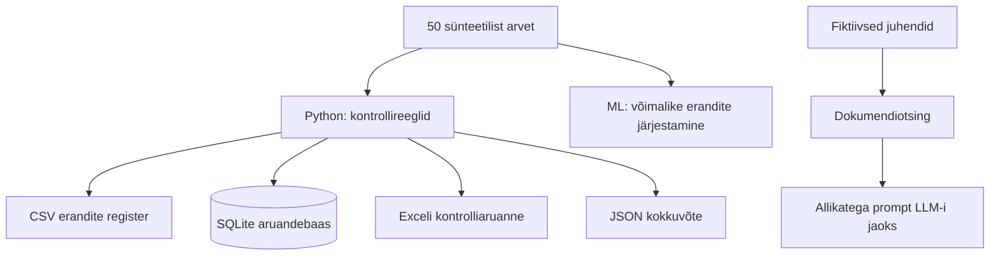

# 10. Labor: tuleviku finantsarvestus Pythoniga

**Õppeaeg:** 60–100 min · **Vajalik:** Python 3; Exceli väljundiks `openpyxl`, ML-osaks valikuline `scikit-learn`.

Selle labori eesmärk on näidata, kuidas moodne Pythoniga ehitatud kontrolli- ja analüüsikiht võiks toetada **olemasolevat** finantsarvestuse töökeskkonda. Kõik labori sisendid on **sünteetilised**. Ühtegi päris SAP-i, RTIP-i ega e-arvekeskuse andmeühendust ei kasutata.

## 1. Mis valmib?



**Oluline:** siin ei koostata ametlikke raamatupidamiskandeid, ei suhelda päris infosüsteemidega ega tehta makseid. Labor näitab kontrolli-, aruandlus- ja otsinguosa.

## 2. Käivitamine Windowsis või Colabis

Ava projektikaustas terminal (Windowsis sobib `py -3`).

```bash
python -m pip install -r requirements.txt
python kood/tuleviku_finantslabor.py
python -m unittest discover -s testid -v
```

Et Pythoni standardteegid on piisavad CSV, JSON ja SQLite jaoks, valmivad need ka ilma lisateekideta. `openpyxl` lisab XLSX-väljundi. Valikuline masinõppeharjutus vajab eraldi:

```bash
python -m pip install scikit-learn
python kood/ml_erandite_demo.py
```

RAG-i eellabor:

```bash
python kood/rag_otsing_demo.py
```

Kui kasutad Thonnyt, ava `kood/tuleviku_finantslabor.py` ja käivita `Run`. Colabis laadi kõigepealt ZIP või projekti failid Colabi keskkonda ja käivita juurkaustast.

## 3. Kuidas aruandeid lugeda?

| Fail | Sisu | Mida sellest õpid? |
|---|---|---|
| `andmed/tuleviku_naidisarved.csv` | 50 fiktiivset arvet | Andmestruktuuri lugemine ja kontrollimine |
| `valjund/tuleviku_kontrollid.csv` | Reeglite tulemused iga arve kohta | Miks erand tuleb inimesele saata |
| `valjund/tuleviku_kontroll.xlsx` | Kontrollide tabel ja kokkuvõte | Excel kui mugav väljund, mitte arvutusmootor |
| `valjund/tuleviku_andmed.sqlite` | Andmed SQL-päringuteks | Kontrollitav andmestik ja päringud |
| `valjund/tuleviku_kokkuvote.json` | Masinloetav raport ja algfaili SHA-256 räsi | Integratsiooni ja andmepäritolu mõiste |

### Näidistulemus

Kaasasoleva, kindla juhuarvuseemnega (`42`) genereeritud 50 arve korral leiti **6 ülevaatust vajavat kirjet**. Põhjused olid võimalik duplikaat (2 kirjel), vale kogusumma (1), puuduv kulukeskus (1), vigane kuupäev (1) ja ebatavaliselt suur arve (1). Kontrollid **ei kinnita**, et ükski neist oleks kuritarvitus; ebatavaline suur arve on aritmeetiliselt korrektne.

### Miks kasutame sentides täisarve?

```python
from decimal import Decimal

neto = Decimal("1000.00")
km = Decimal("240.00")
kokku = neto + km
assert kokku == Decimal("1240.00")
```

Põhjus: binaarse ujukomaga (`float`) võivad tekkida väikesed esitusvead. Tootmises kasutatakse rahasummade jaoks täpset kümnendarvutust või sobivaid täisarve.

## 4. Päringud SQLite'is

Ava `valjund/tuleviku_andmed.sqlite` DBeaveri või DB Browser for SQLite'i abil. Alternatiivina kasuta Pythonit:

```python
import sqlite3
with sqlite3.connect("valjund/tuleviku_andmed.sqlite") as con:
    for row in con.execute("SELECT staatus, COUNT(*) FROM demo_arved GROUP BY staatus"):
        print(row)
```

**Koond ülevaatust vajavatest ridadest:**

```sql
SELECT kirje_id, tarnija, arve_nr, kulukeskus, kokku_senti, kontrollid
FROM demo_arved
WHERE staatus = 'VAJAB_ULEVAATUST'
ORDER BY kirje_id;
```

**Kulukeskuste koond (summa sentides):**

```sql
SELECT kulukeskus, COUNT(*) AS arveid, SUM(kokku_senti) AS kokku_senti
FROM demo_arved
GROUP BY kulukeskus
ORDER BY kokku_senti DESC;
```

**Võimalikud duplikaadid:**

```sql
SELECT tarnija, arve_nr, COUNT(*) AS kordusi
FROM demo_arved
GROUP BY tarnija, arve_nr
HAVING COUNT(*) > 1;
```

**Auditijälje algtase:**

```sql
SELECT source_sha256, versioon, kirjete_arv FROM demo_import;
```

Selle räsi põhjal saab kontrollida algfaili muutumatust. See **ei ole** täielik organisatsiooni auditijälg, sest demokood ei talleta iga üksikmuudatuse autorit, ajatemplit ega toimingut. Ametliku süsteemi logi nõuaks täiendavaid turvameetmeid.

## 5. ML-i katse: mis on anomaalia?

Käivita `kood/ml_erandite_demo.py`. See õpetab `IsolationForest`-mudeli **üksnes sünteetiliste arvesummade** põhjal ja prindib ebatavalisena märgitud read.

Võrdle kahte meetodit:

- Reegel: „Kui netosumma ületab 10 000 €, märgista ülevaatuseks“.
- ML: „Millised summad erinevad üldisest jaotusest kõige enam?“

Küsimus: kas ML-is märgitud kirje on vigane? **Ei saa järeldada.** Erandlikkus ei tähenda valet. Päris kasutuselevõtuks vajaksid rohkem tunnuseid, representatiivseid ajaloolisi andmeid, eksperdi kinnitatud juhtumeid ja tulemuslikkuse mõõtmist.

**Harjutus:** muuda ebatavaliselt suure arve summat failis loogiliselt korrektselt 25 000 eurolt 8 000 eurole (neto 8 000, KM 1 920, kokku 9 920), käivita taas. Tähelepanu: `tuleviku_finantslabor.py` **genereerib algfaili uuesti**, seega kui tahad muudatust katsetada, muuda generaatorkoodi või loo eraldi CSV ning muuda demos selle lugemise loogikat. Ära eelda, et käsitsi muudetud faili sisu säilib demo uuesti käivitamisel.

## 6. RAG-i eelharjutus: dokumentide otsing

`rag_otsing_demo.py` sisaldab nelja **väljamõeldud** juhendilõiku. Programm:

1. võtab küsimuse;
2. otsib märksõnade kattuvuse järgi sobivad lõigud;
3. loob prompti koos allikate nimedega;
4. annab selle teksti sulle kuvamiseks.

**Oluline:** see ei ole veel täielik RAG-rakendus, sest puudub LLM-ile päringu tegemine. See demonstreerib RAG-i **otsingu- ja konteksti koostamise etappi**. Täielikus RAG-is saadetakse leitud lõigud koos küsimusega lubatud LLM-ile, vastus seotakse allikatega ning seda kontrollitakse.

Näidisküsimus:

> Kes kinnitab arve sisulise vastuvõtmise?

Oodatav allikas: „Fiktiivne sisejuhend, v1, § 2“. Vastus: pädev volitatud töötaja, mitte AI ega kontrolliskript.

Teine küsimus:

> Kas AI võib minu eest arve ära kinnitada?

Põhjendatud vastus demomaterjali põhjal: kontroll ei asenda kooskõlastust; kinnitamise eest vastutab volitatud inimene.

**Miks on allikad olulised?** Kui juhend muutub, saab teksti ajakohastada ja otsida uut lõiku. LLM-i üldine teadmine ei pruugi teada, milline asutusesisene reegel praegu kehtib.

## 7. Uue kihi ühendamine praeguse ERP-iga

Harjutuse järgmine arhitektuurisamm on *ainult kavand*:

1. SAP-ist või aruandlussüsteemist saadakse **lubatud CSV-väljavõte** (esialgu asenda see demofailiga).
2. Python kontrollib veerge ja teeb erandite loendi.
3. SQLite salvestab kontrollitulemused koos allika räsiga.
4. XLSX-väljund saadetakse läbivaatamiseks vastutavale töötajale.
5. Töötaja teeb vajadusel paranduse ametlikus süsteemis.

Päris API korral lisanduksid autentimine, rollipõhised õigused, ühenduse veakäsitlus, dokumenteeritud skeemid, piirangud, logimine ja testkeskkond. **Selle labori kood ei sisalda SAP-i liidest ega tohi seda sellisena esitleda.**

## 8. Mõõda uuenduse kasu: väike eksperimenditabel

Tee 10 arve käsitsi kontroll ning mõõda ajakulu; sama 10 arvet kontrolli Pythoniga. Seejärel kontrolli ka Pythonilt märgitud erandid üle. Kasuta malli:

| Mõõdik | Käsitsi | Python + inimese kontroll |
|---|---:|---:|
| Kontrollitud arveid | 10 | 10 |
| Ajakulu minutites | _mõõda_ | _mõõda_ |
| Leitud tõelisi arvestusvigu | _mõõda_ | _mõõda_ |
| Valehäireid | _mõõda_ | _mõõda_ |
| Puuduva konteksti tõttu otsustamata | _mõõda_ | _mõõda_ |

Ära esita selle väikese katse põhjal universaalset tootlikkuse protsenti. See on demonstratsioon ja hüpoteesi esmane kontroll.

## 9. Kolm küsimust pärast käivitamist

1. Miks on võimalik duplikaat ülevaatuse põhjus, aga mitte lõplik tõend topeltmakse kohta?
2. Miks ei saa sünteetiliste arvete `SUM(kokku)` tulemust nimetada HTM-i eelarve täitmiseks?
3. Miks sobib Python summasid kontrollima, aga LLM sobib pigem kontrollitulemuse selgitamiseks?

**Lahendused:** 1) sama number võib tulla andmete ühendamisel, parandusel või korduvülekandel; tuleb vaadata algdokumenti ja maksete seoseid. 2) Puudub ametlik arvestuse alus, periood, valim ja kõik nõuetekohased kanded. 3) Aritmeetika on täpselt kontrollitav, aga teksti loomine on probabilistlik ja vajab allikakontrolli.
