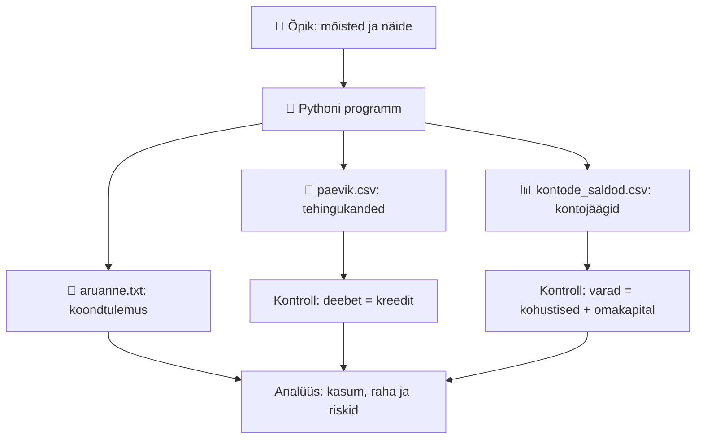

# Raamatupidamine ja finantsaruannete analüüs AI ajastul

> **Eestikeelne praktiline õppeprojekt Richard Barkeri raamatu _Short Introduction to Accounting_ (2011) põhjal.**  
> **Eesmärk:** õppida mõistma majandustehinguid, koostama ja lugema finantsaruandeid, tegema nende põhjal järeldusi ning kontrollima tulemusi Pythoniga.

**Alusta siit → [Ava praktiline õpik](raamatupidamine_barker_praktiline_opik.md)**

Projekt sobib iseseisvaks õppeks, finantsanalüüsi aluste kordamiseks ja esimeseks tööalaseks portfoolionäiteks. Näited on fiktiivsed; need ei asenda Eesti ettevõtte tegelikku raamatupidamist ega maksu- või auditinõustamist.

---

## 1. Mis projektis on?

Kõik järgmised viis faili peavad asuma **samas kaustas** kui see `README.md`.

| Fail | Milleks seda kasutatakse? | Millal avada? |
|---|---|---|
| 📘 [`raamatupidamine_barker_praktiline_opik.md`](raamatupidamine_barker_praktiline_opik.md) | Põhiõpik: 8 peatüki sisuline ülevaade, aruanded, deebet-kreedit, tekkepõhisus, suhtarvud, riskid, DCF, Eesti praktika, SQL ja AI. | **Alusta sellest.** |
| 🐍 [`raamatupidamise_demo.py`](raamatupidamise_demo.py) | Töötav Python 3 näidis, mis koostab kirjenditest saldod ja aruandluse kontrollid. | Pärast õpiku 5.–6. osa. |
| 🧾 [`paevik.csv`](paevik.csv) | Näidistehingute päevaraamat: deebetkonto, kreeditkonto, summa ja rahavoo liik. | Tehingute ning kannete mõistmiseks. |
| 📊 [`kontode_saldod.csv`](kontode_saldod.csv) | Pythoni arvutatud kontojäägid ehk lihtsustatud käibeandmik. | Kandeseoste ja bilansi kontrollimiseks. |
| 📄 [`aruanne.txt`](aruanne.txt) | Programmiga koostatud kokkuvõte: kasum, varad, kohustised, omakapital, rahavood ja kontrollvahed. | Pärast programmi käivitamist. |

> **NB!** `paevik.csv`, `kontode_saldod.csv` ja `aruanne.txt` on programmi väljundid. Pythoni uuesti käivitamisel **kirjutatakse need üle**. Kui soovid CSV-s ise muudatusi teha ja säilitada, kopeeri need enne teise kausta. Näidistehingud on koodis `JOURNAL`-loendis, mitte CSV-failis.

### Kaustastruktuur

```text
raamatupidamise-kiirkursus/
├── README.md                                # Oled siin
├── raamatupidamine_barker_praktiline_opik.md # Teooria, näited ja harjutused
├── raamatupidamise_demo.py                  # Pythoni näidisprogramm
├── paevik.csv                               # Genereeritud päevaraamat
├── kontode_saldod.csv                       # Genereeritud kontosaldod
└── aruanne.txt                              # Genereeritud aruande kokkuvõte
```

Windowsis võivad faililaiendid (`.md`, `.csv`, `.py`, `.txt`) olla peidetud; need on samad failid, mida näed kaustas nimedega `aruanne`, `kontode_saldod`, `paevik`, `raamatupidamine_barker_praktiline_opik` ja `raamatupidamise_demo`.

---

## 2. Soovitatav õpitee

| Samm | Mida lugeda või teha? | Millise oskuse saad? |
|---|---|---|
| **1. Mõttemudel** | Õpiku [osad 1–3](raamatupidamine_barker_praktiline_opik.md#1-kiirstart-kümme-põhimõtet) | Eristad raha, tulu, kulu, vara ja kohustist. |
| **2. Finantsaruanded** | [Osa 4: bilanss, kasumiaruanne, rahavood](raamatupidamine_barker_praktiline_opik.md#4-bilanss-kasumiaruanne-rahavood-ja-omakapital) | Oskad selgitada kolme põhiaruande sisu ja seoseid. |
| **3. Kirjendamine** | [Osa 5: deebet, kreedit, tekkepõhisus](raamatupidamine_barker_praktiline_opik.md#5-kahekordne-kirjendamine-ja-tekkepõhisus) | Mõistad, kuidas tehing muutub kandeks. |
| **4. Üks terviknäide** | [Osa 6: ettevõtte tehingud → aruanded](raamatupidamine_barker_praktiline_opik.md#6-üks-täielik-ettevõttenäide-algusest-lõpuni), seejärel `paevik.csv` ja `kontode_saldod.csv` | Suudad kontrollida aruannete kooskõla. |
| **5. Analüüs** | [Osa 8: suhtarvud ja ohumärgid](raamatupidamine_barker_praktiline_opik.md#8-kuidas-finantsaruandeid-analüüsida) | Hindad likviidsust, kasumlikkust ja kasumi kvaliteeti. |
| **6. Väärtus ja riskid** | [Osa 9: kasv, risk, DCF](raamatupidamine_barker_praktiline_opik.md#9-kasv-väärtus-riskid-ja-dcf) | Mõistad kapitali tootlust, finantsvõimendust ja rahavoogudel põhinevat väärtust. |
| **7. Töövahendid** | Käivita `raamatupidamise_demo.py`; vaata [osa 11: Excel, SQL, Python, AI](raamatupidamine_barker_praktiline_opik.md#11-kaasaegne-töövoog-excel-sql-python-ja-ai) | Kinnistad õpitu automaatsete kontrollidega. |

Kui eelistad kindlat ajakava, järgi õpiku [7-päevast õppeplaani](raamatupidamine_barker_praktiline_opik.md#12-seitsmepäevane-õppeplaan-ja-oskuste-test) (soovituslikult 2–3 tundi päevas).

---

## 3. Kiirstart: käivita Pythoniga aruannete demo

### Variant A — Thonny (algajale kõige lihtsam)

1. Hoia kõik projektifailid ühes kaustas.
2. Ava **Thonny** ja selles fail `raamatupidamise_demo.py`.
3. Vajuta **F5 / Run**.
4. Loe alumises aknas kuvatud aruannet.
5. Ava samas kaustas `paevik.csv`, `kontode_saldod.csv` ja `aruanne.txt` (näiteks Excelis või tekstiredaktoris).

Vaja on ainult **Python 3**. Väliste teekide paigaldamine (`pip install ...`) **ei ole vajalik**.

### Variant B — Windowsi terminal / PowerShell

Ava terminal projektikaustas ja käivita:

```powershell
python raamatupidamise_demo.py
```

Kui sinu süsteemis on Python käivitatav `py` abil, kasuta:

```powershell
py raamatupidamise_demo.py
```

### Mida programm kontrollib?

- Iga tehingu deebeti ja kreediti võrdsust ning kontode koondsaldode tasakaalu.
- Valemit **varad = kohustised + omakapital**.
- Valemit **perioodi rahamuutus = äritegevuse + investeerimise + finantseerimise rahavood**.
- Näidisettevõtte arvutustulemuste vastavust koodis etteantud kontrollväärtustele.

**Oodatavad tulemused:**

| Näitaja | Tulemus |
|---|---:|
| Tulud kokku (`Müügitulu` + `Teenusetulu`) | 35 000 € |
| Kulud kokku | 27 600 € |
| **Puhaskasum** | **7 400 €** |
| Varad kokku | 45 400 € |
| Kohustised | 18 000 € |
| Omakapital | 27 400 € |
| Äritegevuse rahavoog | 6 400 € |
| Investeerimise rahavoog | −12 000 € |
| Finantseerimise rahavoog | 35 000 € |
| **Raha lõppsaldo** | **29 400 €** |
| **Bilansi- ja rahavoogude kontrollvahe** | **0 €** |

Arvestusnäide ei käsitle käibemaksu ega ettevõtte tulumaksu ning programm **ei ole terviklik raamatupidamistarkvara**.

---

## 4. Kuidas viis faili omavahel seotud on?



### Jälgi ühte tehingut algusest lõpuni

Näites müüb ettevõte kaupa **15 000 €** eest arvega (raha ei laeku kohe):

1. Päevaraamatus: **deebet „Nõuded ostjatele“ 15 000 €**, **kreedit „Müügitulu“ 15 000 €**.
2. Kasumiaruandes tekib müügitulu, kuid sellest tehingust raha veel ei laeku.
3. Hiljem tasub klient **12 000 €**: **deebet „Raha“**, **kreedit „Nõuded ostjatele“**.
4. Bilanssi jääb kliendi tasumata nõue **3 000 €**; pangaraha suureneb 12 000 €, kuid uut müügitulu ei teki.
5. Täieliku kasumi saamiseks tuleb kajastada ka müüdud kaupade soetusmaksumus (**6 000 €**) ning muud kulud.

**Õppetund:** müügitulu, kasum ja laekunud raha ei ole üks ja seesama.

---

## 5. Kolm kontrollküsimust enne järgmise teema juurde minekut

<details>
<summary><strong>1. Ettevõte sai pangast 15 000 € laenu. Kas see on müügitulu või kasum?</strong></summary>

Ei. Raha suureneb ja ühtlasi suureneb kohustis. Kasumiaruande müügitulu sellest tehingust ei teki; rahavoog liigitatakse finantseerimiseks.

</details>

<details>
<summary><strong>2. Miks võib ettevõte näidata kasumit, aga sattuda makseraskustesse?</strong></summary>

Osa müügist võib olla veel laekumata; raha võib olla seotud varudega; samal ajal võivad saabuda tarnijate maksetähtajad ja laenumaksed. Seetõttu tuleb kasumi kõrval analüüsida tegevusrahavoogu, käibekapitali ning kohustiste tähtaegu.

</details>

<details>
<summary><strong>3. Kas bilansi võrdsuse täitmine tähendab, et kõik kanded on õiged?</strong></summary>

Ei. Näiteks sama summa kandmine valele kulukontole võib jätta deebeti ja kreediti võrdseks. Vaja on kontrollida ka algdokumente, õiget perioodi, konto valikut, kajastamisreegleid ja ebatavalisi tehinguid.

</details>

Rohkem küsimusi ja arvutusülesandeid on [õpiku 12. osas](raamatupidamine_barker_praktiline_opik.md#12-seitsmepäevane-õppeplaan-ja-oskuste-test).

---

## 6. Soovitatav iseseisev praktiline ülesanne

1. Ava `paevik.csv` ja selgita iga 14 kande juures, **milline vara, kohustis, tulu või kulu muutub**.
2. Ava `kontode_saldod.csv`. Veerg **`deebet_miinus_kreedit`** tähendab: positiivne on deebetsaldo ja negatiivne kreeditsaldo; see **ei tähenda automaatselt kahjumit**.
3. Võrdle `aruanne.txt` väärtusi õpiku [6. osa aruannetega](raamatupidamine_barker_praktiline_opik.md#6-üks-täielik-ettevõttenäide-algusest-lõpuni).
4. Leia vastus: **miks on puhaskasum 7 400 €, kuid tegevusrahavoog ainult 6 400 €?** Selgita nõuete, varude, võlgade ja kulumi kaudu.
5. Kirjuta 5–10-lauseline **juhtkonna memo**: kas näidisettevõte on kasumlik, kas tema raha suurenes ja mille arvelt ta kasvas?

**Lisaväljakutse:** muuda programmis `JOURNAL`-loendi mõnd tehingut ja kontrolli, milline mõju avaldub kõigis kolmes väljundis. Kui muudatuse järel etteantud kontrollväärtuse `assert` annab vea, tähendab see, et demonstratsiooni ootustulemus enam ei kehti — see ei tõesta iseenesest, et sinu uus tehing on majanduslikult vale.

---

## 7. Piirangud ja allikas

- **Põhiraamat:** Richard Barker, _Short Introduction to Accounting_, Cambridge University Press (2011); õppematerjal katab raamatu kõigi kaheksa peatüki põhiideed.
- **Kaasaegsed täiendused:** Eesti praktika, SQL, Python, AI, tänapäevane finantsanalüüs ja programminäide on raamatust lähtuvad täiendused, mitte väide, et need kõik sisalduvad Barkeri raamatus.
- **Märkus Eesti kohta:** raamatus toodud illustratiivseid maksustamise eeldusi ei tohi võtta Eesti kehtiva maksusüsteemi kirjeldusena. Tegelikuks tööks kontrolli alati asjakohaseid Eesti õigusakte ja juhendeid.
- **Programmi ulatus:** lihtsustatud fiktiivne õppenäide, mitte valmis ERP, maksu-, auditi- ega aastaaruandluse lahendus. Kõigi arvuliste kontrollide edukas läbimine ei taga majandustehingute sisulist õigsust.

---

**Kõige mõistlikum esimene samm:** ava [praktiline õpik](raamatupidamine_barker_praktiline_opik.md), loe osad 1–6 läbi ning seejärel käivita [Pythoni demo](raamatupidamise_demo.py). Kui oskad `aruanne.txt` iga olulise numbri päritolu selgitada, on projekti põhieesmärk täidetud.
